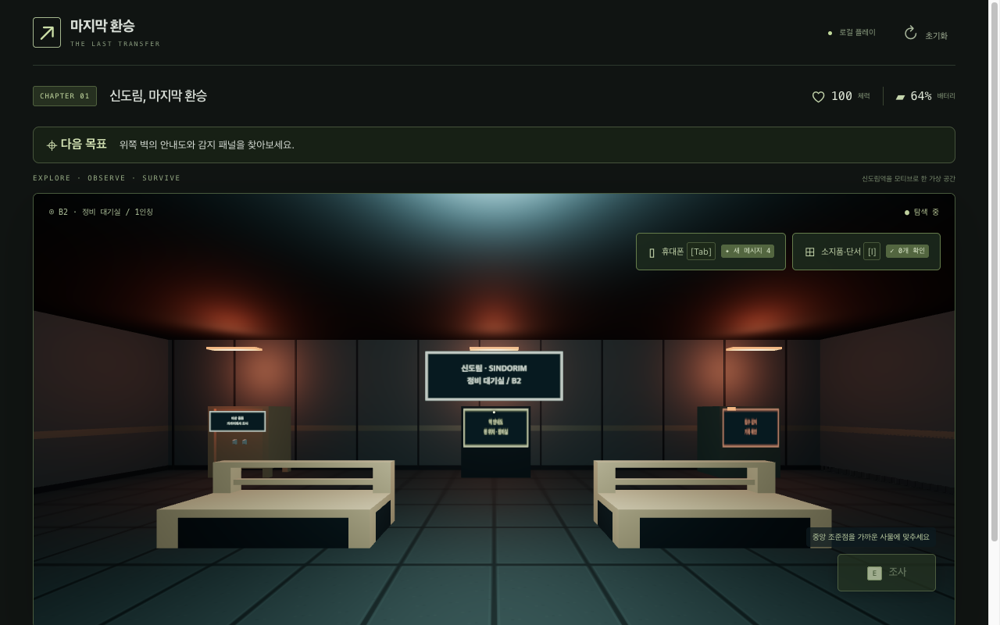
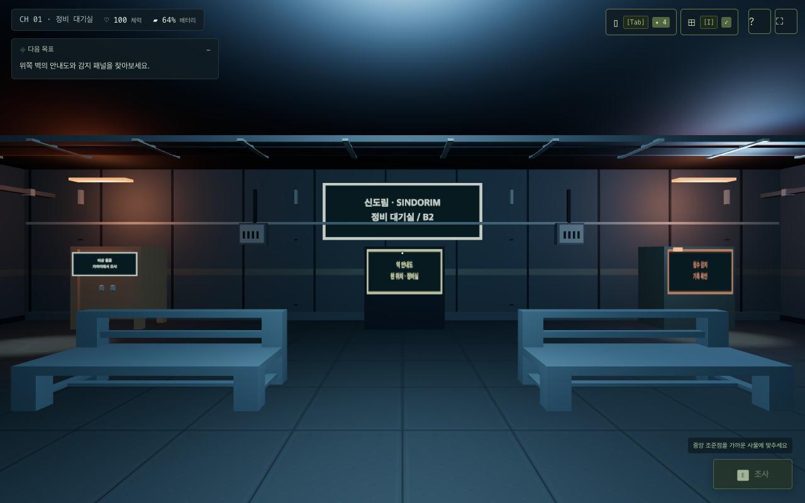
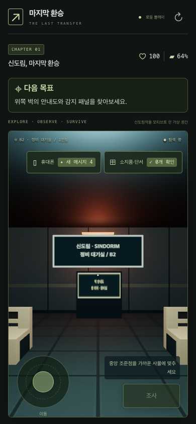
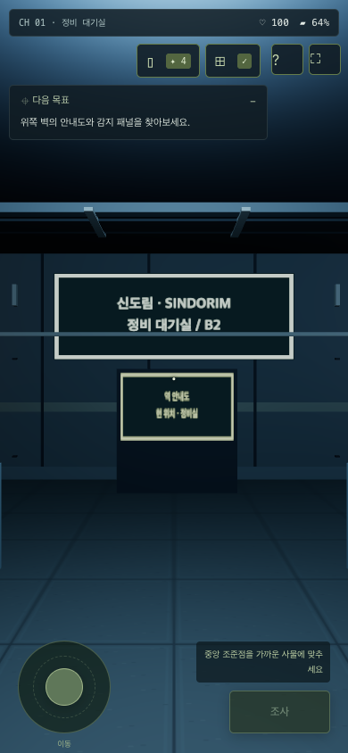
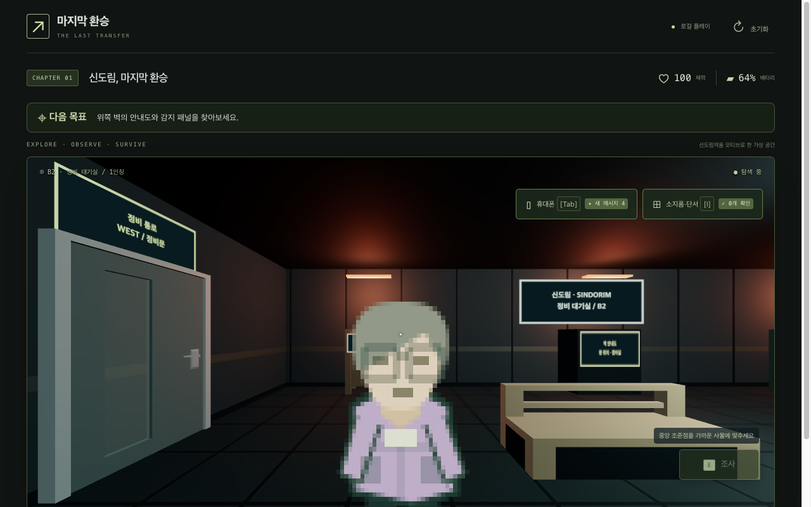
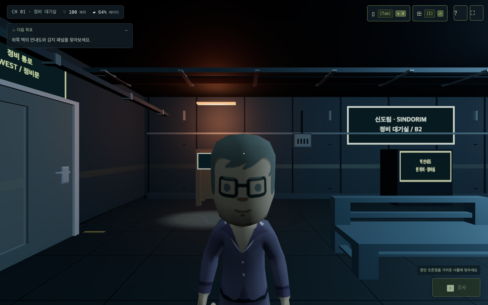

# 첫 방 비주얼 개선 기록

후속 환경·시설 표현 변경은 [첫 방 환경 개선 비교](environment.md)를 참조하세요. 아래 `before-*`/`after-*`는 이전 HUD·캐릭터 개선 당시 기록으로 보존합니다.

같은 저장 좌표·시점에서 촬영한 실제 Chrome 화면입니다. PC: 1280×800, 모바일 에뮬레이션: 390×844, DPR 1. 시작 좌표 `(480, 460)`, yaw/pitch 0을 유지했습니다. NPC 비교 좌표는 `(220, 420)`, yaw/pitch 0입니다. 변경된 화면 비율 때문에 투영 구도는 달라지지만 플레이어 위치와 시점은 같습니다. 이전 저장 좌표·게임 판정·캐릭터 정체는 변경하지 않았습니다.

| 화면        | 개선 전                           | 개선 후                          |
| ----------- | --------------------------------- | -------------------------------- |
| PC          |     |     |
| 모바일      |  |  |
| 현장 오반장 |     |  |

[축소된 복귀 안내](after-resume.png) · [조작 도움말](after-help.png) · [360×640](after-layout-360x640.png) · [844×390](after-layout-844x390.png) · [1920×1080](after-layout-1920x1080.png)

## 측정

헤드리스 Chrome의 SwiftShader, Vite 개발 빌드에서 자산 로드·워밍업 후 requestAnimationFrame 간격을 4초간 한 번씩 수집했습니다. `renderer.info.render`의 프레임별 제출 드로콜·삼각형을 함께 기록했습니다. 전후 모두 그림자 맵은 비활성입니다. **GPU 프레임 시간·실제 모바일 기기 벤치마크가 아니며, RAF는 화면 갱신 주기와 스케줄링에 제한됩니다.** 따라서 프레임률 향상이나 모든 기기에서의 성능을 보장하지 않습니다.

| 환경    | 캔버스 면적         | 드로콜  | 제출 삼각형   | 평균 RAF         | P95 RAF          |
| ------- | ------------------- | ------- | ------------- | ---------------- | ---------------- |
| desktop | 1179×555 → 1280×800 | 56 → 23 | 1,390 → 3,644 | 16.67 → 16.67 ms | 16.80 → 16.80 ms |
| mobile  | 356×569 → 390×844   | 23 → 14 | 572 → 3,340   | 16.67 → 16.88 ms | 16.70 → 16.80 ms |

환경 디테일과 실제 NPC 모델로 삼각형 수는 늘었지만 정적 메시를 재질별 병합해 드로콜을 줄였습니다. PC 평균 표시 주기는 약 60Hz를 유지했고 모바일 에뮬레이션은 약 59Hz였습니다. 측정 원본: [before-metrics.json](before-metrics.json), [after-metrics.json](after-metrics.json).

벤치에는 기존에 보이던 충돌용 박스가 겹쳐 있었습니다. 그림자 맵은 원래부터 꺼져 있어 그림자 acne를 원인으로 판단하지 않았습니다. 충돌 박스는 시각 출력에서 제외하고 원래 충돌·레이캐스트를 유지했으며, 벤치 재질을 저채도·높은 거칠기로 조정했습니다. 모든 실제 GPU에서의 시간적 점무늬·깜빡임 제거까지 확인한 것은 아닙니다.

## 검증 범위

- 360×640, 390×844, 844×390, 1280×800, 1920×1080: 캔버스 가용 화면 채움, 가로 넘침 없음, HUD 버튼이 화면 안에 있는지 검사하고 캡처했습니다.
- 목표 접기·펼치기와 도움말 버튼이 탐색 복귀 클릭으로 사용되지 않는지 확인했습니다. HUD·메뉴의 시각적 배치를 스크린샷으로 확인했습니다.
- FBX 인물·스킨·대기 애니메이션 로드 완료와 오류 안내 없음, Runtime 예외 없음, 기본 외부 AI 요청 0회를 확인했습니다.
- 첫 방 실제 키보드 이동·충돌·E 조사·오반장 대화·암호 클리어·챕터 2 연결·저장 재시작·모바일 터치 조작을 별도 브라우저 플레이 검사로 확인했습니다. Tab/I/Esc와 입력창·메뉴 전환 충돌도 검사했습니다.
- 2~6장 전체를 다시 플레이한 검사는 아닙니다. 각 장의 유효한 합성 저장 체크포인트로 공통 HUD와 기존 2D 렌더러를 확인했습니다: [대합실](after-2d-hall.png), [승강장](after-2d-platform.png), [객실](after-2d-trainB.png), [문래역](after-2d-moonPlatform.png), [정비 통로](after-2d-maintenance.png). 게임·저장 회귀는 기존 단위 테스트를 함께 실행했습니다.
- 실제 모바일 기기, Safari/Firefox, 주소창 변화·노치·발열·메모리·GPU 성능은 미검증입니다. safe-area CSS와 viewport-fit=cover를 적용했지만 실기기 검증을 대체하지 않습니다. 선택적 전체화면 API는 지원되는 브라우저에서 사용자 버튼으로만 요청하며 브라우저 정책에 따라 거부될 수 있습니다.
- 3D 로더 청크는 약 711KB(gzip 약 186KB)로 빌드 크기 경고가 남습니다. 모델·애니메이션은 합계 약 757KB, 스킨은 약 21KB이며 프로젝트에서 로컬 제공합니다.

## 에셋

Kenney [Furniture Kit](https://kenney.nl/assets/furniture-kit)와 [Animated Characters Protagonists](https://kenney.nl/assets/animated-characters-protagonists), 모두 CC0입니다. 실제 적용 파일·원본 라이선스·스킨 수정 내역은 [에셋 기록](../../public/art/README.md)을 참조하세요. 벽·바닥·설비 디테일은 프로젝트 코드로 작성했습니다.

## 재실행

```sh
VISUAL_LABEL=after FIRST_PERSON_CHECK=visual npm run test:browser
FIRST_PERSON_CHECK=1 npm run test:browser
FIRST_PERSON_CHECK=shortcuts npm run test:browser
```

현재 코드에서 `VISUAL_LABEL=before`를 실행해도 이전 구현을 복원하지는 않습니다. 기존 `before-*` 파일은 실제 변경 전에 확보한 기록이므로 비교 자료를 보존하려면 덮어쓰지 마세요. 브라우저 검사는 임시 프로필을 사용하며 실제 플레이 저장은 건드리지 않습니다. 현재 첫 방 전용 `npm run test:browser:first` 명령은 AI를 비활성화하고 백엔드 없이 실행합니다. 기존 통합 `test:browser`는 Java 빌드가 필요합니다.
